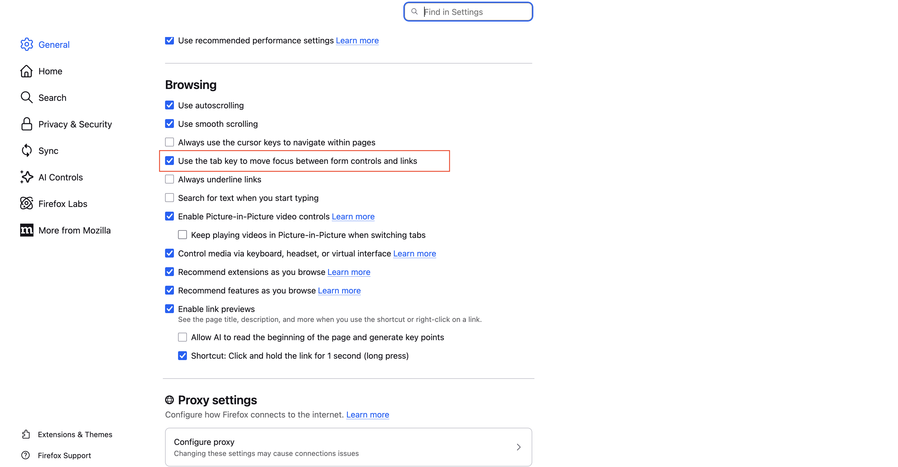
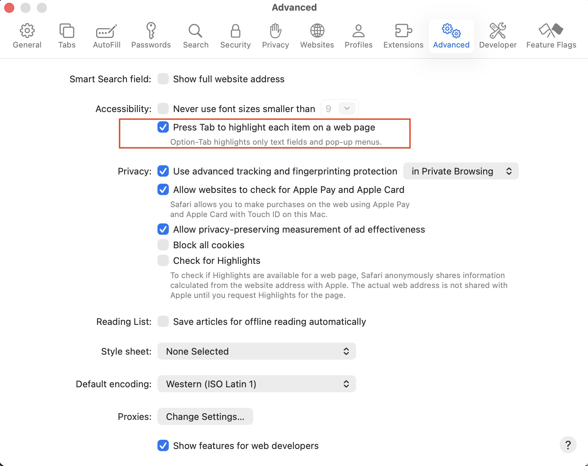

# IQ limitations

This page lists the known limitations of IQ.

## User interface

### Conversation history

- Chat history does not persist across sessions in the user interface.
- Resetting a session or closing the interface permanently clears the active context. Conversations cannot be recovered or replayed in the chat window.
- Exporting and reviewing previous conversations are not supported.
- Enabling [cross-session memory (RAG)](./installation/enable-rag.md) lets IQ retrieve relevant context from past conversations and inject it into a new session. It does not restore the previous transcript in the user interface.

### Localization

- The UI displays text in English only. Non-English locales display the UI text in English.

### Input and output

- The interface supports text input only. Rich text, file attachments, images, and documents are not supported.
- Voice input and text-to-speech are not supported.

### Accessibility

To enable full accessibility within the IQ interface, turn on keyboard navigation settings in your browser.

**Firefox**

**Safari**

{ width="600" }

## Backend services

### Service scope

- IQ requires a fully containerized HCL DX Core or DX Compose deployment running in Kubernetes. Traditional deployments, where HCL DX runs on WebSphere Application Server (WAS) outside of containers, are not supported.
- Hybrid deployments, where HCL DX Core runs on WAS alongside separately containerized services, are not supported. The IQ Integrator must run within the same Kubernetes cluster as your HCL DX deployment.
- The MCP Server is the only IQ component that supports operation outside of a full HCL DX deployment, through its `standaloneMode` configuration. All other IQ components require a complete Kubernetes-based DX environment.
- The IQ backend server is designed specifically for WebSocket-based AI integration and session management.
- The service manages only the session state, conversation messages, and orchestration between the client, LLMs, and Model Context Protocol (MCP) servers.
- The service does not replace or alter existing DX Core functionality.

### Integrator

- If a browser or tab is closed, or if a network issue occurs, background MCP Server tools that have already started may not stop immediately. Use the **Cancel** button to stop processing safely, and then ask the LLM in chat to undo or correct any partial changes if needed. Closing the browser window or reloading the page while background operations are running can result in incomplete or inconsistent data states.
- If you navigate away from, close, or reload the IQ interface while a request is being processed, the assistant reply may not be broadcasted to the UI and the request may only be partially processed. To avoid lost responses or partial results, wait for the current turn to complete before leaving the interface.

### AI model

- Knowledge of HCL DX architecture, APIs, and configurations is restricted to documentation available prior to the model's training data cutoff date and excludes subsequent updates, features, or best practices. For more information about the latest releases and features, refer to the official [HCL DX](https://help.hcl-software.com/digital-experience/9.5/latest/){target="_blank"} and [HCL DX Compose](https://help.hcl-software.com/digital-experience/dx-compose/latest/){target="_blank"} documentation.
- IQ has been extensively tested and validated with Claude Sonnet 4.6 and Sonnet 5.5 for general purpose tasks, and Claude Haiku 4.5 for summarization. While alternative LLM models may work, compatibility is not guaranteed. Due to the rapidly evolving nature of AI model releases, newer models may introduce parameter changes or tool calling behavior incompatibilities. For configuration details and compatibility warnings, refer to [Deploying LiteLLM in-cluster](./installation/deploy-litellm.md#deploying-litellm-in-cluster).
- OpenAI reasoning model variants (for example, GPT-5.x decimal-versioned models such as `gpt-5.4`, `gpt-5.5`, or `gpt-5.6-sol`) are not supported. These models automatically inject a `reasoning_effort` parameter that conflicts with IQ's function tools and causes errors: `Function tools with reasoning_effort are not supported`.

### Database

- Multi-pod and production deployments do not support in-memory SQLite due to session state inconsistency across instances. For multi-pod environments, use PostgreSQL to ensure consistent session state and conversation history across all service instances.
- Database names are fixed to `iqdb` for internal and Runtime Controller (RTC)-managed databases. External databases allow custom database names.
- Cross-session memory (RAG) requires PostgreSQL with the `pgvector` extension. The extension is included by default in internal databases managed by DX Persistence Node or DX Runtime Controller. For external PostgreSQL databases, you must explicitly enable the `pgvector` extension using `CREATE EXTENSION IF NOT EXISTS vector;`. Refer to [Enabling cross-session memory (RAG)](./installation/enable-rag.md#prerequisites) for configuration details.
- Embedding dimension mismatch causes graceful degradation: If the `EMBEDDING_DIMENSIONS` environment variable no longer matches the output dimension of the registered embedding model after initial startup, IQ silently disables cross-session memory while continuing to serve requests. Recreate the RAG tables to apply dimension changes. Refer to [Changing RAG and embedding configuration](./installation/enable-rag.md#changing-rag-and-embedding-configuration).

## MCP Server

### Deployment

- The MCP Server must be deployed within the same Helm chart as the Integrator to establish automatic network connectivity.
- WCM and DAM tools are unavailable to the MCP Server unless they are explicitly enabled through the `enableWcm` and `enableDam` Helm configuration values. At least one of these tool domains must remain enabled for the readiness probe to report the MCP Server as healthy.
- The `standaloneMode` parameter disables HCL DX user authentication integration, causing the MCP Server to function in isolation.

### Scope and enablement

- Available tool domains depend on feature flags (`ENABLE_DAM`, `ENABLE_WCM`, `STANDALONE_MODE`). Disabled domains are not exposed through the MCP Server.
- Authentication tool behavior in standalone mode differs from integrated deployment behavior.

### Response and output

- Token-Oriented Object Notation (TOON) encoding applies strictly to JSON text tool payloads. Non-JSON text and non-text content are not transformed.
- TOON encoder loading failures cause responses to automatically fall back to standard JSON text format.
- Response-detail modes (`summary` and `full`) apply strictly to Digital Asset Management (DAM) and Web Content Manager (WCM) tools. Other tools do not expose mode selection.

### Request and session behavior

- Stateless request processing prevents the use of session persistence or sticky-session configurations.
- Sequential requests in multi-replica environments route to any available pod rather than maintaining a connection to a specific instance.

### Payload and transport

- The server rejects JSON-RPC requests that exceed the configured body-parser limit.
- The `BODY_PARSER_JSON_LIMIT` Helm chart configuration value controls payload capacity limits.

### Context propagation

- Cookie and virtual portal contexts propagate from provided request parameters.
- Missing or invalid context values cause downstream requests to use default behavior.

### Monitoring and readiness

- Liveness checks only confirm process availability, not full backend dependency health.
