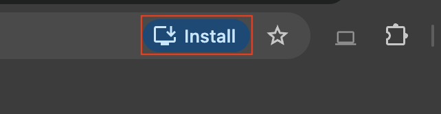
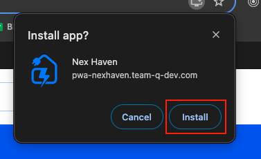
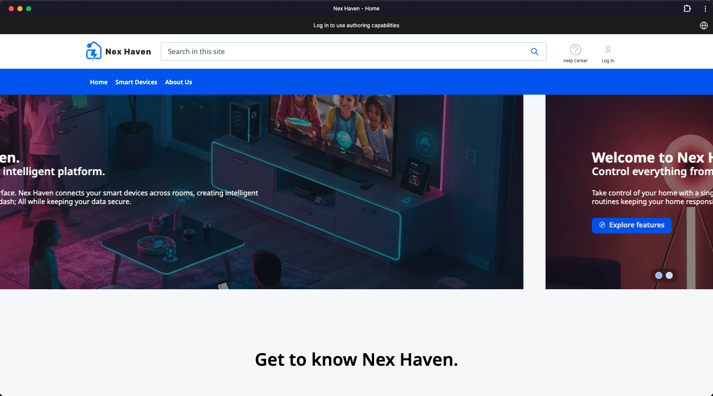

# Progressive Web Applications

Progressive Web Applications (PWAs) offer a delivery pattern that can transform a website into an experience that feels like a native application using browser-based functionality. PWAs use web browser APIs and features along with progressive enhancement strategy. Using PWA artifacts such as a service worker, caching provisions, and a manifest file can deliver faster load times, easier navigation, and responsive behavior. PWAs allow offline capability and access to native device capabilities without writing any native code.

For more information, refer to [Introduction to Progressive Web Applications](https://developer.mozilla.org/en-US/docs/Web/Progressive_web_apps/Introduction){target="_blank"} and [Progressive Web Applications with HCL Digital Experience (DX) 9.5](https://www.youtube.com/watch?v=JP1cWlM1s2k){target="_blank"}.

!!!note
    PWAs typically serve a single site. HCL DX uses virtual portals to extend PWA capabilities across multiple sites. For more information on virtual portal support, refer to [Separating and sharing resources between virtual portals](../virtual_portal/vp_planning/advppln_scope.md).

## Prerequisites

Ensure the application meets these criteria before installation:

- Serve over HTTPS with a valid certificate (or use localhost for development).
- Include a Web App manifest file that contains the following:
    - `short_name` or `name`
    - `icons` (must include a 192px and a 512px icon)
    - `start_url`
    - `display` (must be either `fullscreen`, `standalone`, or `minimal-ui`)

    !!! note
        `prefer_related_applications` must not be present, or be `false`.

- Register a service worker with a functional fetch handler.

To install an application in Google Chrome that meets these criteria:

1. Open the application in the browser.
2. Select **Install** in the address bar to open the confirmation dialog.

    

3. Select **Install** in the dialog to complete installation and launch the application.

    

4. Launch the application and display the icon as a Chrome application.

    

## Architecture and scope

PWAs require correct scope configuration for both the manifest and the service worker. The web application manifest file provides information about a web application in JSON format.

The combination of modules, files, and metadata allows HCL DX 9.5 to serve files required by the PWA application and restrict which web pages users can view while applying the manifest. Navigating outside the scope reverts the application to a standard web page in a browser tab or window.

HCL DX 9.5 CF19 and Container Update CF192 add new platform and component support to add these capabilities to HCL DX 9.5 and higher sites. These include:

1. System module updated in HCL DX 9.5 CF19 to serve manifest and service worker files.
2. Theme scope module defined in `theme.json` to load `pwa.js`.
3. Page metadata created for use on the root page of the site or designated subpages.
4. Sample site configured as an installable PWA. PWA installation and display are verified on the following mobile browser platforms:

    - Apple Safari on Apple mobile devices running iOS v13 and v14 (desktop access is not supported)
    - Google Chrome 85 on macOS and Windows
    - Microsoft Edge 85 on macOS and Windows 10
    - Google Chrome 85 on Android v7 tablets and Google Pixel 3 running Android v11
    - Google Chrome 86 on Linux
    !!! note
        PWA functionality is not supported on all web browser platforms (for example, [Microsoft Internet Explorer 11.](https://www.microsoft.com/en-us/download/details.aspx?id=41628){target="_blank"}) Developers are encouraged to verify if PWA support is available for web browser platforms intended for use.

You can reuse file artifacts such as `theme.json`, `pwa.js`, and `service-worker.js` in other HCL DX 9.5 CF19 and higher themes.

- Manifest scope defines the navigation boundary of the application and restricts accessible web pages while the manifest applies. Navigating outside the scope signals an out-of-scope state, which can disable native page operations. Set the scope directly in manifest files or by using the `com.hcl.dx.pwa.manifest.scope` page metadata parameter on the Progressive Web Application configuration node. Setting the scope value to `auto` uses the friendly name of the page.

- Service worker scope determines which paths and files the service worker controls and intercepts. The default scope uses the directory of the service worker file and applies to all descendant directories.

    !!! note
        - When registering a service worker, you can specify a scope with a more restrictive path, but that path must be a child of the directory containing the service worker. In HCL DX, the theme path containing the service worker and the site page path reside in different hierarchies. HCL DX 9.5 defaults the scope to the friendly URL of the root label or page of the PWA site. Setting a less restrictive scope requires a `Service-Worker-Allowed` header on the service worker response. - The PWA theme module uses the friendly URL of the root page of the PWA site for the `Service-Worker-Allowed` header value. Set this same value as the scope when registering the service worker in the theme.

## Authenticated and unauthenticated access

HCL DX generates URLs differently based on user authentication. Unauthenticated sites use `/wps/portal/` while authenticated sites use `/wps/myportal/`. These URL generation differences significantly affect PWA processing. Use the site-scoped metadata parameter `com.hcl.dx.pwa.app.protected` to distinguish between protected and non-protected states. This parameter affects how the manifest file generates `start_url` and scope settings, as well as the service worker scope (`/portal` or `/myportal`) when using `auto`.

Setting `com.hcl.dx.pwa.app.protected` also alters how `service-worker.js` generates the PWA configuration cache key (`pwaConfigCacheKey`).

- When set to `false` (default), the `+` install icon in the browser address bar displays when an unauthenticated user accesses the home page. An unauthenticated user can install the application at this point. If the user authenticates before installing the application, the `+` icon disappears from the address bar.
- When set to `true`, the `+` install icon does not display in the address bar until the user authenticates.

## Localization

By default, the `manifest.json` file does not provide localization information. A single `name` and `descriptions` field sets the application name. To handle localization for HCL DX PWA applications, the following `manifest.json` fields extend to include an array of localized values:

- `descriptions`
- `names`
- `short_names`
- `shortcuts`:
    - `names`
    - `descriptions`

        ```json
        "name": "Sample App",
        "names": [
            {
                "value": "Sample application",
                "lang": "en"
            },
            {
                "value": "Beispielanwendung",
                "lang": "de"
            }
        ],
        ```

In this example, if a user accesses the HCL DX PWA using German language preferences, the application name displays as **Beispielanwendung**. If a user accesses the application in a language that is not defined in the manifest, HCL DX uses the value from the name field as a fallback.

## Hiding pages in PWA application mode

Smaller devices might not appropriately display an entire site designed for desktop. Setting the `pwa.Hidden` metadata to `true` on a page hides that page in PWA application mode.

Theme CSS implements hidden pages in two locations:

- Add CSS to `css/default/default.css` in the static files directory. For example, to set the display mode to `hidden` for HCL DX pages in PWA application mode:

    ```css
            @media all and (display-mode: standalone) {
        .pwaHidden {
            display: none;
        }
    }
    ```

- Update the theme navigation JSP in `themes/html/dynamicSpots` in the dynamic files directory. When `pwa.Hidden` is `true`, apply the `pwaHidden` CSS class to the `li` element to hide the page. For example, to add the hidden page metadata parameter to `mainNav.jsp` in a custom theme:

    ```java
    <c:set var="pwaHidden" value="${node.metadata['pwa.Hidden']}"></c:set>
    <li class="list-item <c:if test='${pwaHidden == true}'>pwaHIdden</c:if>">
        <a href="$
    {fn:escapeXml(node.urlGeneration.autoNavigationalState.clearScreenTemplate)}">
        <c:out value="${node.title}" />
        </a>
    </li>
    ```

## Enabling PWA in an HCL DX site

1. Configure stateless URLs required for PWAs in HCL DX 9.5 CF19 and higher using one of the following methods:

    - Use the Configuration Wizard or page properties UI. For more information, refer to [Defining friendly URLs without state information for pages in your site](../../deployment/manage/siteurl_cfg/changing_siteurl/cw_navstate/mp_friendly_short_url.md).

    - Manually configure system environment variables and theme parameters:

        1. Set the following `WP_ConfigService` resource environment variables as follows:

            - `stateless.urls.enabled=true`
            - `generate.stateless.urls=true`
            - `generate.stateless.redirect.urls=true`

        2. Update theme parameters to include:

            ```xml
            <parameter name="com.ibm.portal.theme.hasBaseURL" type="string"
            update="set"><![CDATA[true]]></parameter>
            ```

        3. Restart the HCL DX 9.5 server.

        !!!note
            PWA installation options vary by device and browser (for example, Chrome on macOS or Safari on iOS). Steps 2 through 11 apply to custom themes or sites.

2. Create a `pwas` directory in the root of the theme static files. This directory contains PWA configurations. Each subdirectory under `pwas` represents a single configuration. For example:

    ```plaintext
    pwas/
        nexhaven/
            images/
                manifest.json
                service-worker.js
    ```

3. Create a folder in the `pwas` directory to represent the site configuration.
4. Create a `manifest.json` file in the PWA configuration folder. Include the following fields:

    - `short_name` or `name`
    - `icons` (must include a `192px` and a `512px` icon)
    - `scope` (optional) restricts accessible web pages while applying the manifest. Navigating outside the scope signals an out-of-scope state, which can disable native page operations. Set the scope directly in the manifest file or by using the `com.hcl.dx.pwa.manifest.scope` page metadata parameter on the PWA configuration node (typically the root label or page of the site). Setting the scope value to `auto` uses the friendly name of the page or label.
    - `start_url` specifies the preferred URL loaded when a user launches the web application. Set `start_url` directly in the manifest file or by using the `com.hcl.dx.pwa.manifest.start_url` page metadata parameter on the PWA configuration node, which is typically the root label or page of the site. Setting the value to `auto` uses the friendly name of the root page. If the root is a label, `start_url` defaults to the path of the first child under that label.
    - `display` (`fullscreen`, `standalone`, or `minimal-ui`)
    - `prefer_related_applications` (must not be present, or must be `false`)

5. Create a `service-worker.js` file in the PWA configuration folder. Multiple PWA configurations can share the same service worker file. HCL DX checks for `service-worker.js` in the PWA configuration directory first. If `service-worker.js` is not present in that directory, HCL DX checks the root `pwas` directory.
6. Create a theme-scoped module in the `theme.json` file in the contributions directory in the root of the static files. This module loads `pwa.js` to register the PWA service worker. For example:

    ```json
    {
        "id":"wp_theme+pwa",
        "prereqs": [
            {
                "id":"wp_pwa"
            }
        ],
        "contributions": [
            {
                "type":"config",
                "sub-contributions": [
                    {
                        "type":"js",
                        "uris": [
                            {
                                "value":"/js/pwa.js"
                            }
                        ]
                    }
                ]
            }
        ],
        "titles": [
            {
                "value":"PWA support",
                "lang":"en"
            }
        ],
        "descriptions": [
            {
                "value":"PWA support",
                "lang":"en"
            }
        ]
    },
    ```

7. Add the `pwa.js` file referenced in the theme-scoped module to the `js` directory in the root of the static files. The `pwa.js` file registers the service worker with the browser.
8. Add the theme-scoped module (`wp_theme_pwa` from `theme.json`) to the theme profiles. For example, `update deferred_profile.json`:

    ```
                "wp_one_ui",
                "wp_one_ui_dijit",
                "wp_theme_pwa"
            ],
    ```

9. If required by your deployment, clear the theme caches using the Theme Analyzer. For more information, refer to [Theme Analyzer](../themes_skins/the_module_framework/themeopt_analyzer/index.md).

10. Add metadata values to pages. For details on how `com.hcl.dx.pwa.app.protected` affects parameter behavior, refer to [Authenticated and unauthenticated access](#authenticated-and-unauthenticated-access).

    - `com.hcl.dx.pwa.configuration` (required): Set on the root label or page of the site to identify the PWA configuration in the theme `pwas` directory. For example, set this parameter to `nexhaven` on the site root label.
    - `com.hcl.dx.pwa.app.protected` (optional): Set on the root label or page of the site to specify whether the application applies to authenticated (`true`) or unauthenticated (`false`) site sections. Defaults to `false`.
    - `com.hcl.dx.pwa.serviceworker.scope` (optional): Set on the root label or page of the site to override the service worker scope used to register the service worker with the browser (typically `/wps/myportal/nexhaven`). Setting the value to `auto` (default) sets the service worker scope to the friendly path of the PWA configuration node.
    - `com.hcl.dx.pwa.preload_urls` (optional): Set on the root label or page of the site to define a comma-separated list of preloaded URLs. The service worker dynamically adds this list using the `preloadURLs` variable.
    - `com.hcl.dx.pwa.manifest.scope` (optional): Set on a label or page to override the `scope` specified in the PWA manifest (typically `/wps/myportal/nexhaven`). Setting the value to `auto` sets the scope to the friendly path of the PWA configuration node.
    - `com.hcl.dx.pwa.manifest.start_url` (optional): Set on a label or page to override the `start_url` specified in the PWA manifest.
    - `pwa.Hidden` (optional): Set on a label or page to exclude a page from PWA application navigation (`true` or `false`).

11. Update theme files to hide pages in PWA application mode (optional). For more information, refer to [Hiding pages in PWA application mode](#hiding-pages-in-pwa-application-mode).

PWA support in Virtual Portals: Typically, PWAs are designed to serve a single site. Because HCL DX is capable of serving multiple sites through [Virtual Portal](../virtual_portal/vp_planning/advppln_scope.md) support, HCL DX administrators should be able to configure multiple sites to implement PWA capabilities.


