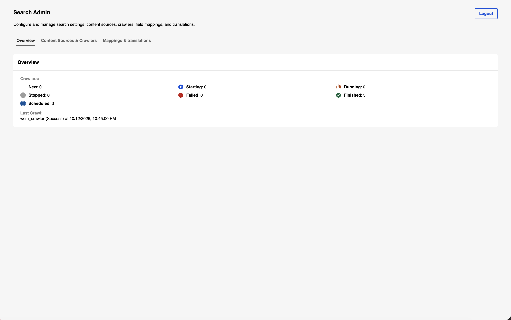
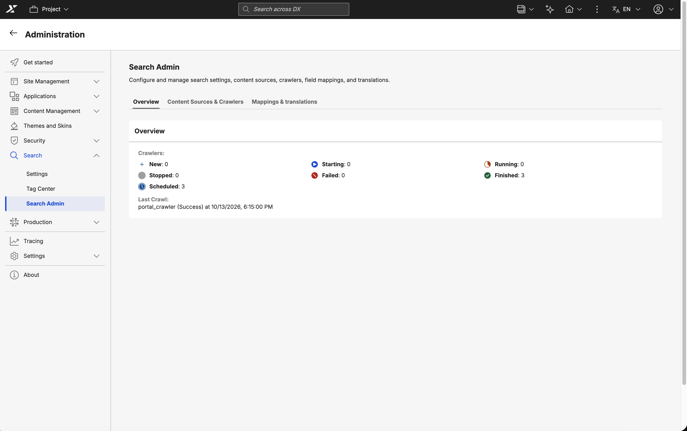

# Accessing the Search Admin UI

Grant users access to the Search Admin UI by assigning the required resource permissions based on your deployment method.

!!! note
    Access to the Search Admin UI is restricted to administrator users only. For more information, refer to [Working with resource permissions](../../deployment/manage/security/people/authorization/controlling_access/working_with_resource_permission/index.md).

## Standalone Search Admin UI

Access the Search Admin UI as a standalone application when you want to manage search configuration directly, without going through the Portal. This method is useful when Practitioner Studio is not deployed, or when you want to administer search independently of an active DX session. Standalone access requires permissions on the **Pages** resource only.

1. Log in to HCL Digital Experience (DX) as an administrator.
2. Navigate to **Open applications menu > Administration > Security > Resource Permissions > Pages > Content Root > Practitioner Studio > Administration > Search > Search Admin**.
3. Assign the **Administrator** role to the user or group.
4. Open `https://<host>/dx/ui/search/admin-ui`.

    

## Search Admin UI in Practitioner Studio

Access the Search Admin UI inside Practitioner Studio when you want to manage search alongside your other administration tasks in a single Portal session. This method keeps search administration in the same place as the rest of your site management tools. Practitioner Studio access requires permissions on both the **Pages** and **Portlets** resources.

1. Log in to HCL Digital Experience (DX) as an administrator.
2. Navigate to **Open applications menu > Administration > Security > Resource Permissions > Pages > Content Root > Practitioner Studio > Administration > Search > Search Admin**.
3. Assign the **Administrator** role to the user or group.
4. Navigate to **Portlets > Search Center Administration portlet**.
5. Assign at least the **User** role to the user or group.
6. Navigate to **Practitioner Studio > Administration > Search > Search Admin**.

    
