# Managing common field mappings

Use the Search Admin UI to manage common field mappings.

Common field mappings map the fields used in search to the corresponding `documentObject` field for each content source type. Each content source type indexes with default field mappings.

!!! note
    You cannot rename or delete required field mappings (title, description, link, type, and tags). You can only modify their mapped value for each content source type, or add and modify custom fields.

## Mappings & translations tab

On the **Mappings & translations tab**, you can do the following tasks:

### Viewing common field mappings

In the **Common Field Mappings** section, view the list of existing common field mappings.

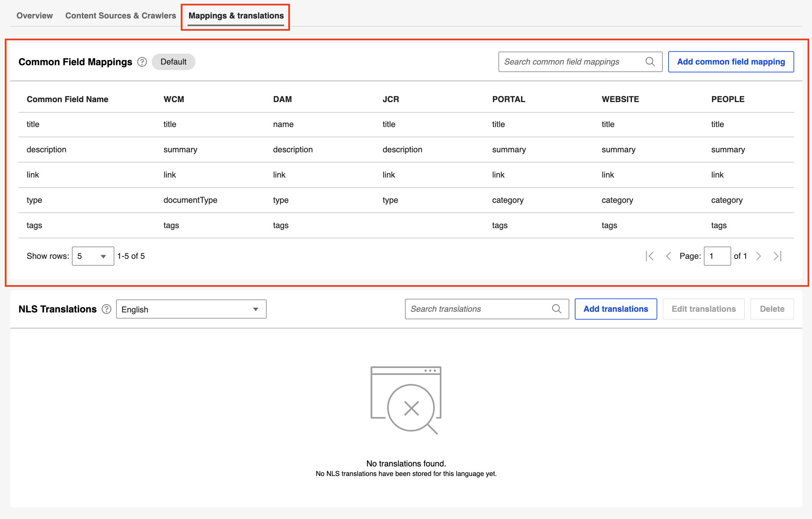

If your common field mapping are unedited, the section displays a **Default** label.

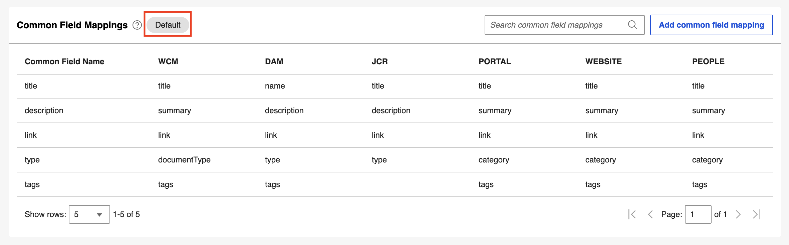

If you change any mapped value in a common field mapping, or add a custom field mapping, the label changes to **Customized**. <!--Let me know if this is accurate-->

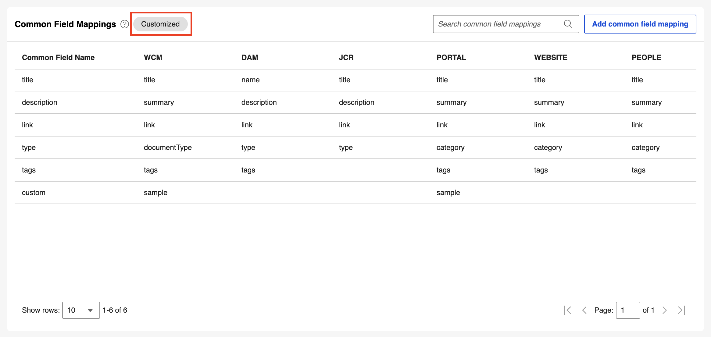

### Adding a common field mapping

1. Select **Add common field mapping**.

    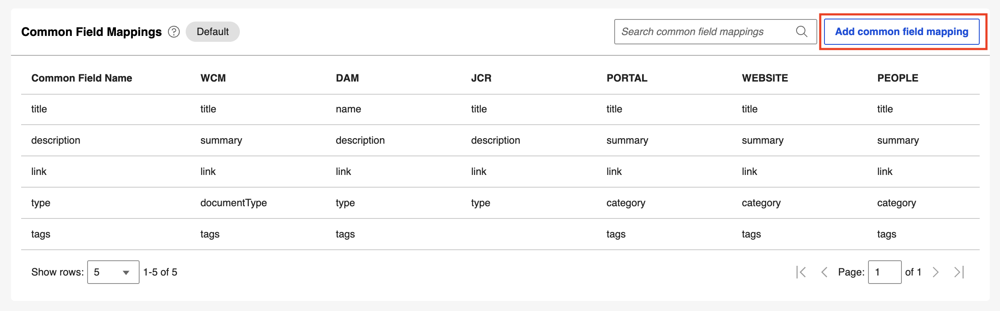

2. In the **Add Common Field Mapping** dialog box, enter a **Common Field Name** and its mapped value for each type (**WCM**, **DAM**, **JCR**, **PORTAL**, **WEBSITE**, and **PEOPLE**).

    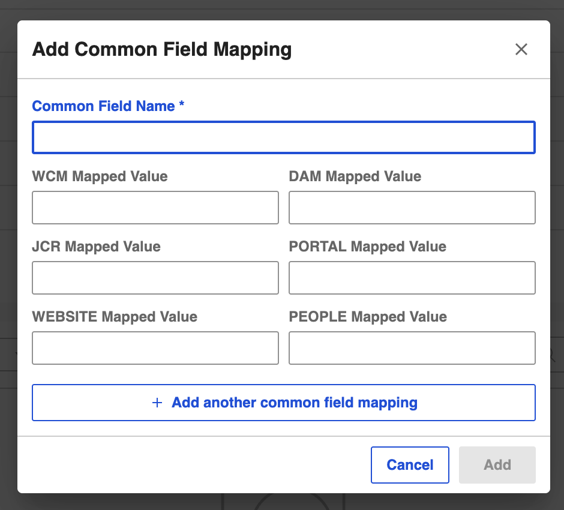{: width="500" style="display: block; margin: 0 auto;"}

3. To add more common field mappings in the same dialog box, select **Add another common field mapping**.

    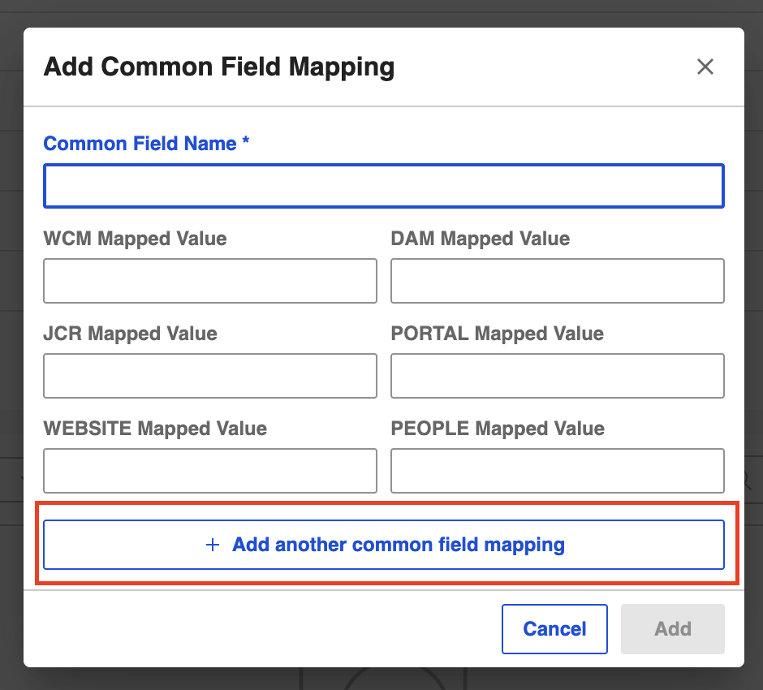{: width="500" style="display: block; margin: 0 auto;"}

4. Select **Add**, or select **Cancel**. If you select **Cancel**, select **Discard** to discard changes or **Keep editing** to return to the dialog box.

### Searching for a common field mapping

1. Select the **Search common field mappings** box and enter a search term.
2. Select the search icon or press **Enter**. The list is filtered to show the common field mappings matching the search term.

    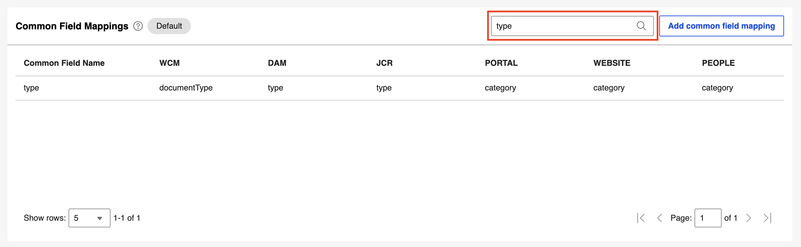

### Updating a common field mapping

1. Hover over a common field mapping.
2. Select the **Edit mapping** icon.

    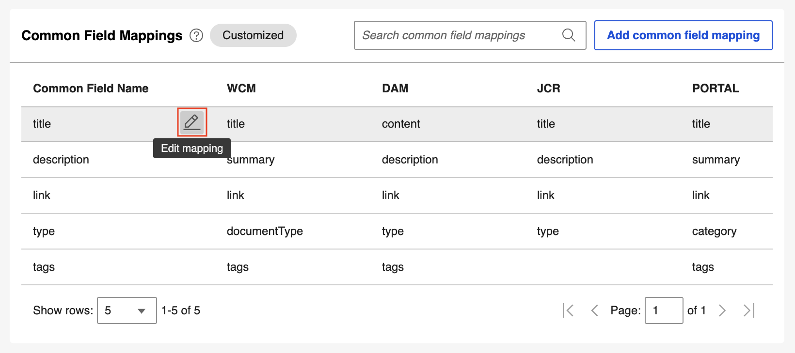{: width="800" style="display: block; margin: 0 auto;"}

3. In the dialog box, edit the mapped values you want to change, and then select **Save**.

    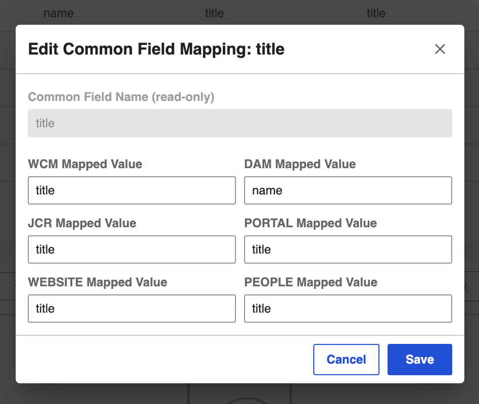{: width="500" style="display: block; margin: 0 auto;"}

### Deleting a common field mapping

!!!note
    - You can only delete a custom common field mapping.
    - Deleting a custom field removes it from the list for all content source types.

1. Hover over a mapping.
2. Select the **Delete** icon.

    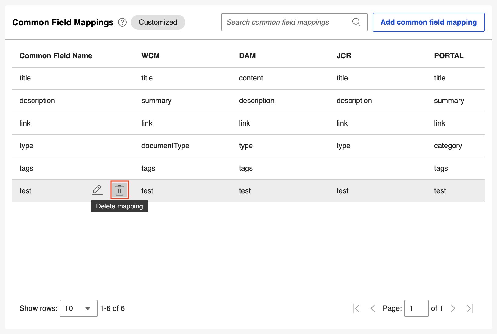{: width="800" style="display: block; margin: 0 auto;"}

3. In the confirmation dialog box, select **Delete** to confirm, or select **Cancel**.

    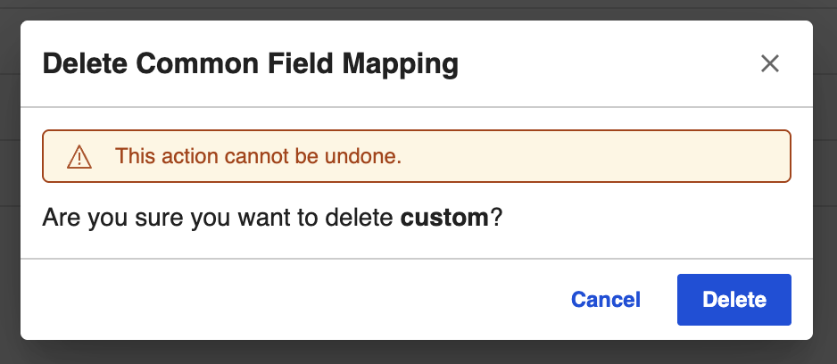{: width="500" style="display: block; margin: 0 auto;"}
