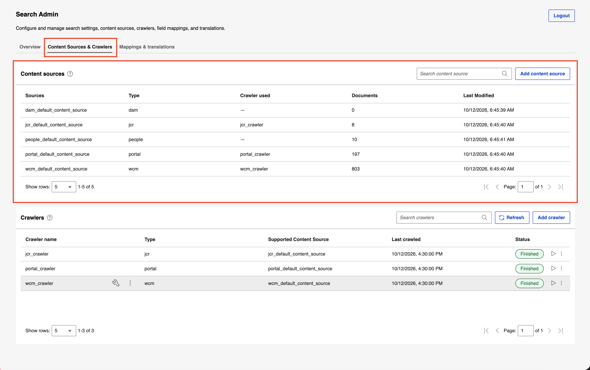
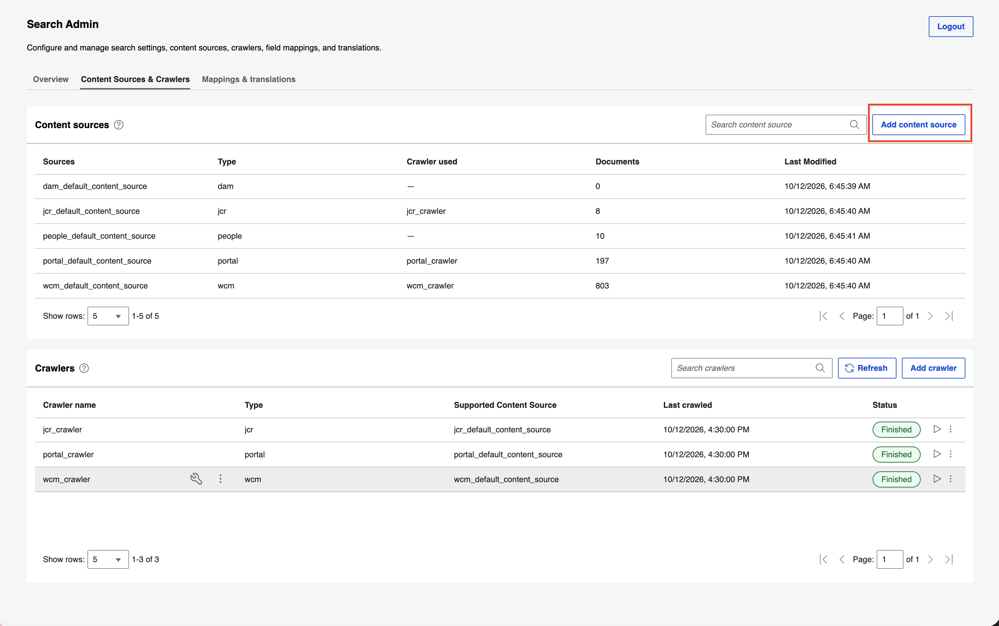
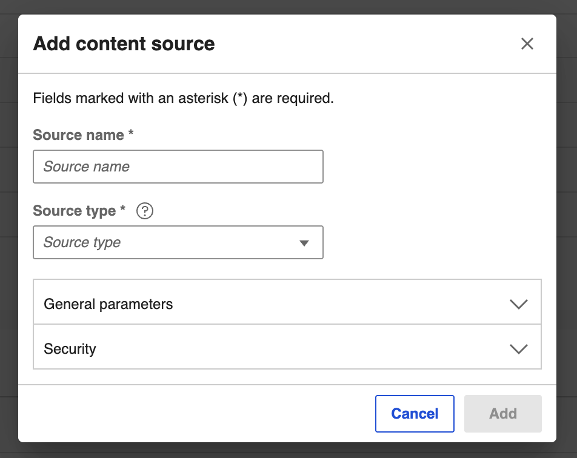
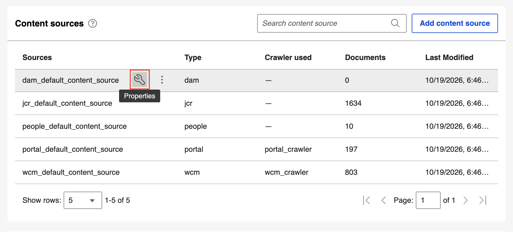
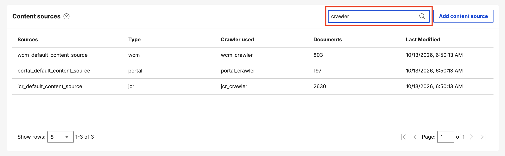
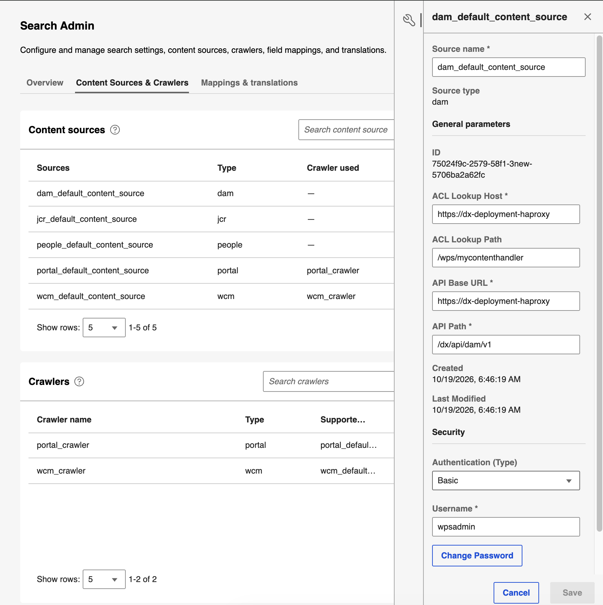
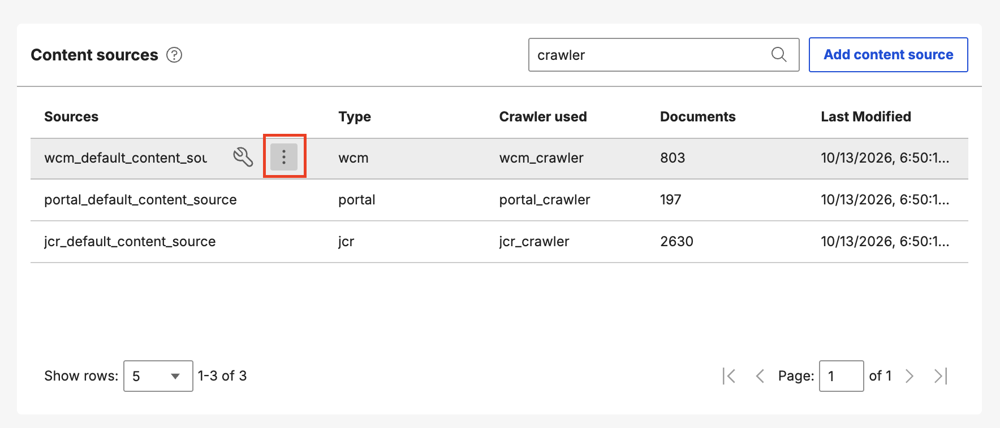
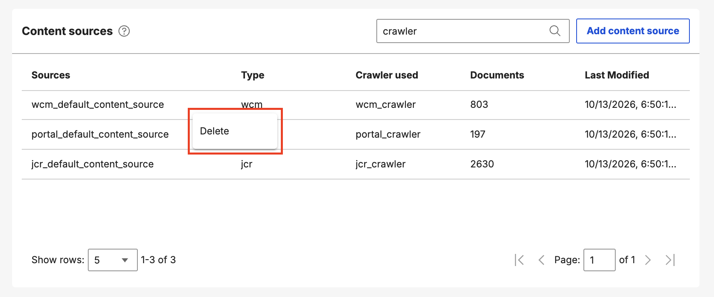
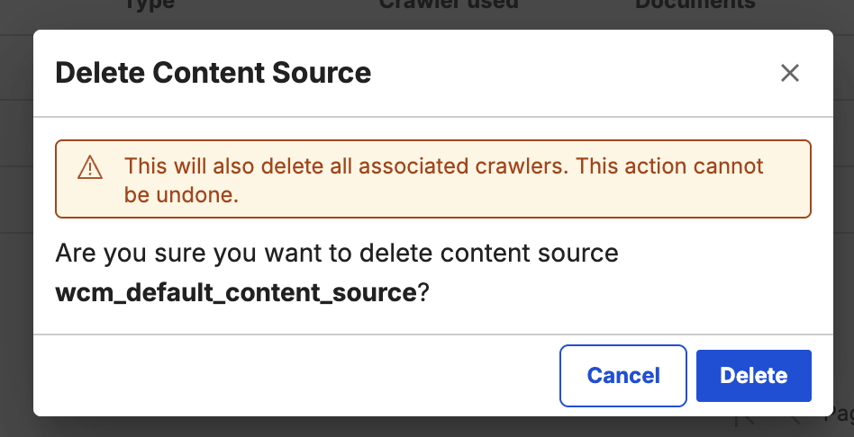

# Managing content sources

Use the Search Admin UI to manage content sources.

A content source represents a single search engine index where items are indexed and searched. The following content source types are available:

- Digital Asset Management (DAM)
- Java Content Repository (JCR)
- People
- Portal
- Web Content Manager (WCM)
- Website

!!! note
    DAM and People content sources do not have an associated crawler. Instead, they use the Content Push API to push documents directly to the search index. For more information about content sources that use crawlers, refer to [Crawlers](crawlers.md).

## Content Sources & Crawlers tab

On the **Content Sources & Crawlers** tab, you can do the following tasks:

### Viewing content sources

In the **Content sources** section, view the list of existing content sources.

### Creating a content source

1. Select **Add content source**.

    

2. Enter the following details:

    {: width="500" style="display: block; margin: 0 auto;"}

    - **Source name:** Enter a unique name for the content source (for example, `dam_default_content_source`).
    - **Source type:** Select the content source type from the drop-down list (**WCM**, **DAM**, **JCR**, **PORTAL**, **PEOPLE**, or **WEBSITE**).
    - **General parameters:** Expand the section to configure the following connection parameters:
        - **ACL Lookup Host:** Enter the host URL used for Access Control List (ACL) lookups (for example, `https://dx-deployment-haproxy`).
        - **ACL Lookup Path:** Enter the endpoint path used for ACL lookups (for example, `/wps/mycontenthandler`).
        - **API Base URL:** Enter the base URL of the source service API (for example, `https://dx-deployment-haproxy`).
        - **API Path:** Enter the endpoint path for the content API (for example, `/dx/api/dam/v1`).
    - **Security:** Expand the section to configure the following authentication settings:
        - **Authentication (Type):** Select the authentication protocol (**None**, **Basic**, or **Form**). Selecting **None** requires no additional settings.
        - If you select **Basic** or **Form**, enter the following additional details:
            - **Username**: Enter the administrative username for authenticating with the source (for example, `wpsadmin`).
            - **Password**: Enter the account password.
            - **Login path**: Enter the authentication endpoint path (for example, `/wps/mycontenthandler/!ut/p/um/currentuser`).
        - If you select **Form**, enter the following additional details:
            - **Username field**: Enter the form field name for the username (for example, `username`).
            - **Password field**: Enter the form field name for the password (for example, `password`).

    <!--Please confirm if the descriptions are correct and adequate, especially for Security. If we can be more specific on the descriptions, that would be great-->

3. Select **Add**, or select **Cancel**. If you select **Cancel**, select **Discard** to discard changes or **Keep editing** to return to the dialog box.

### Viewing content source properties

1. Hover over a content source row.
2. Select the **Properties** icon.

    

    The **Properties** panel displays the source name and type, general parameters (such as ID, ACL lookup host and path, and API base URL and path), and security settings (such as authentication type, username, and login path).

### Searching for a content source

1. Select the **Search content source** box and enter a search term.
2. Select the search icon or press **Enter**. The list filters to show all content sources that match the search term you entered.

### Updating a content source

1. Hover over a content source row.
2. Select the **Properties** icon.
3. In the **Properties** panel, edit the properties, and then select **Save**.

    {: width="700" style="display: block; margin: 0 auto;"}

### Deleting a content source

1. Hover over a content source row.
2. Select the **More actions** icon.

    

3. Select **Delete**.

    

4. In the confirmation dialog box, select **Delete** to continue, or select **Cancel**.

    {: width="500" style="display: block; margin: 0 auto;"}

    Deleting a content source removes it from the list and makes it unavailable for search indexing. If the content source has an associated crawler that is not currently running, the crawler is also deleted.
