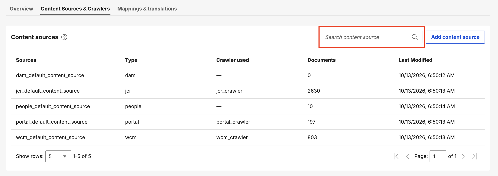

# Managing content sources

This section describes how to manage content sources in the Search Admin UI.

A content source represents a single index in the search engine that items can be indexed to and searched from. The following content source types are available:

- Digital Asset Management (DAM)
- Java Content Repository (JCR)
- People
- Portal
- Web Content Manager (WCM)
- Website

!!! note
    DAM and People content sources do not have an associated crawler. Instead, they use the Content Push API, which allows these content sources to push documents directly to the search index. For more information about content sources that use crawlers, refer to [Crawlers](crawlers.md).

On the **Content Sources** panel, you can do the following tasks:

## Viewing content sources

1. Go to the Search Admin UI.
2. Click the **Content Sources & Crawlers** tab.

    

The list of existing content sources is displayed.

## Creating a content source

1. Click **Add content source**.

    

2. Fill up the required fields in the dialog that opens, then save your changes.

    

## Viewing content source properties

1. Hover on a content source row.
2. Click the **Properties** icon beside the content source title.

The properties panel opens, showing the source name and type, general parameters (such as ID, ACL lookup host and path, API base URL and path, and the created and last modified dates), and security settings (such as authentication type, username, and login path).

## Searching for a content source

1. Click the **Search content source** field.

    

2. Enter a search term. The list is filtered to show all content sources that match the search term.

    

## Updating a content source

1. Hover on a content source row.
2. Click the **Properties** icon.
3. In the properties panel, edit the properties, then click **Save**.

    

## Deleting a content source

1. Hover on a content source row.
2. Click the **Overflow** icon, then click **Delete**.

    

    

3. In the confirmation dialog, click **Delete** to continue, or click **Cancel** to cancel the deletion.

    

Deleting a content source removes it from the list and makes it unavailable for search indexing. If the content source has a corresponding crawler, the crawler is also deleted, provided it is not currently running.
