# Managing crawlers

This section describes how to manage crawlers in the Search Admin UI.

A crawler pulls data from a content source and indexes it for search.

!!! note
    Crawler functionality is only available for JCR, Portal, WCM, and Website content source types. DAM and People content sources do not support crawlers; they use the Content Push API instead. For more information, refer to [Content Sources](content_sources.md).

## Overview

Click the **Overview** tab to see a summary of the number of crawlers for each status, as well as details of the most recent crawl, including the crawler name, status, date, and time.

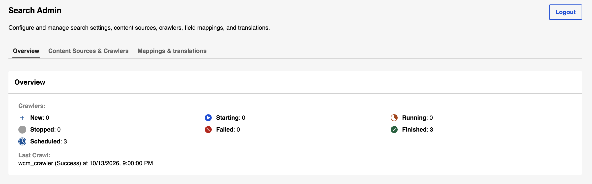

On the **Crawlers** panel under the **Content Sources & Crawlers** tab, you can do the following tasks:

## Viewing crawlers

1. Go to the Search Admin UI.
2. Click the **Content Sources & Crawlers** tab.

    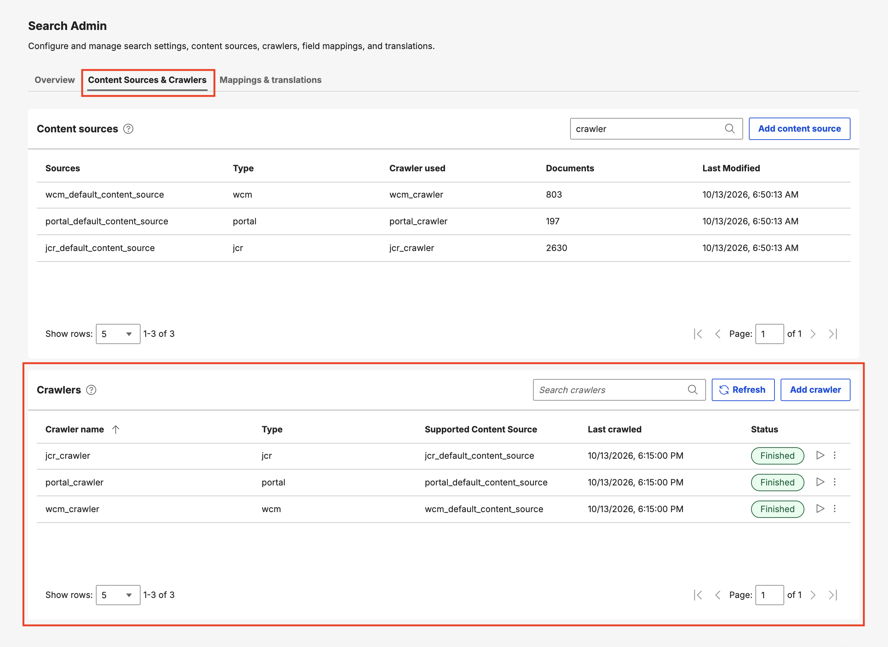

The list of existing crawlers is displayed.

## Creating a crawler

1. Click **Add crawler**.

    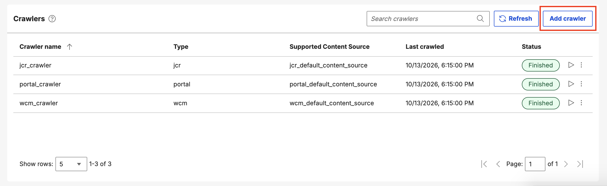

2. Fill in the required fields in the dialog that opens, then click **Create**.

    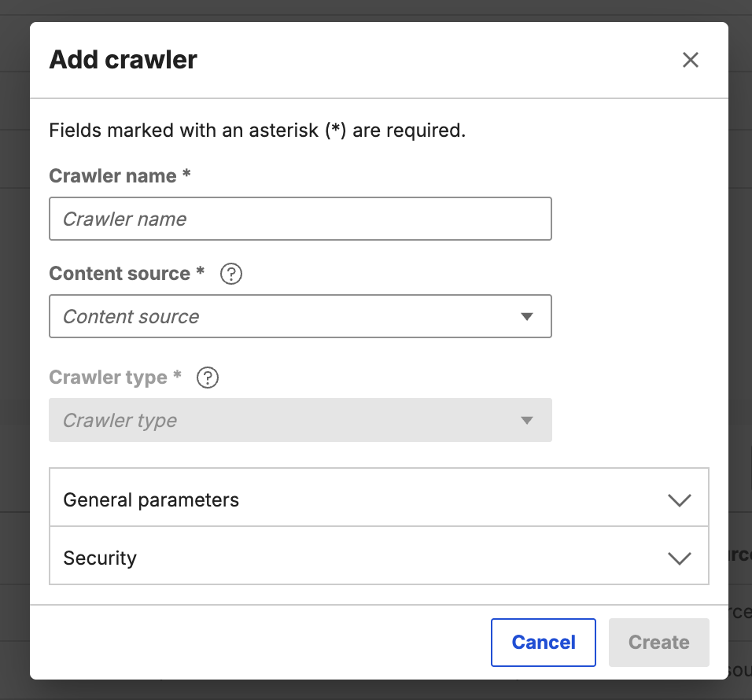

## Viewing crawler properties

1. Hover on a crawler row.
2. Click the **Properties** icon.

    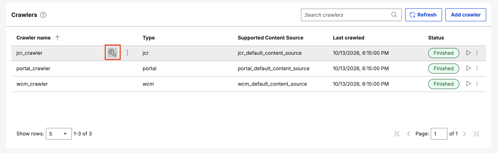

The properties panel opens, showing the crawler name, type, and supported content source; general parameters (such as ID, target data source, schedule, crawl limits, crawl delay, blacklist regex, robots.txt handling, last crawled date, and last crawl duration); and security settings (such as authentication type).

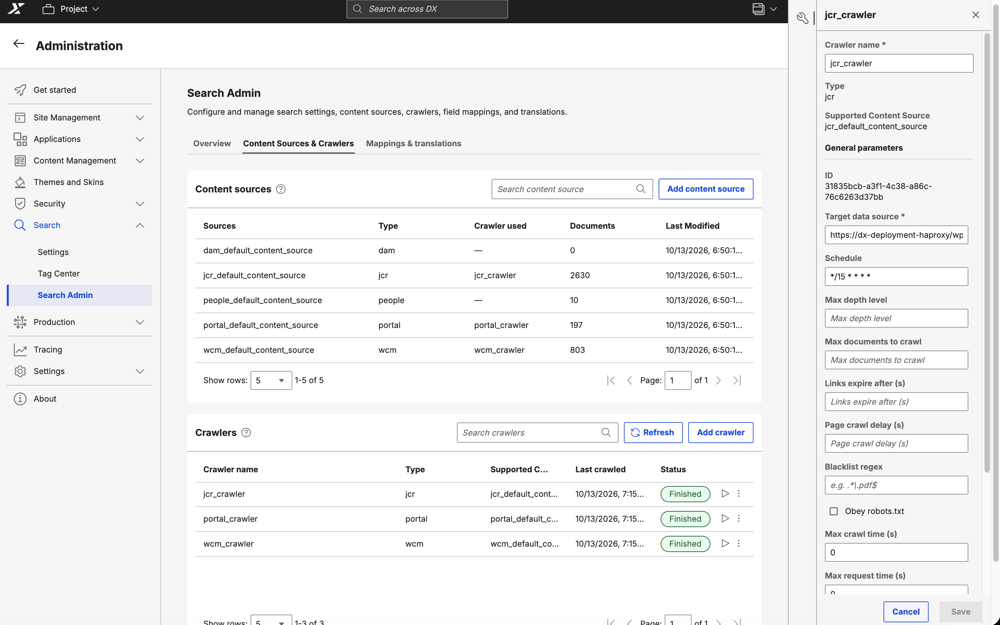

## Searching for a crawler

1. Click the **Search crawler** field.

    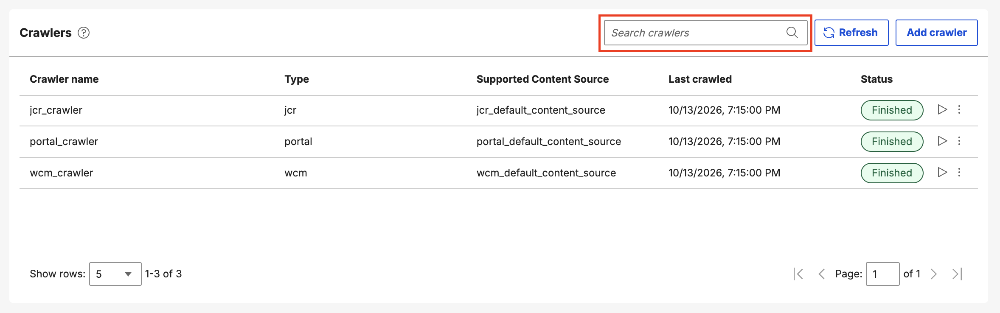

2. Enter a search term. The list is filtered to show all crawlers that match the name, type, or associated content source name you entered.

    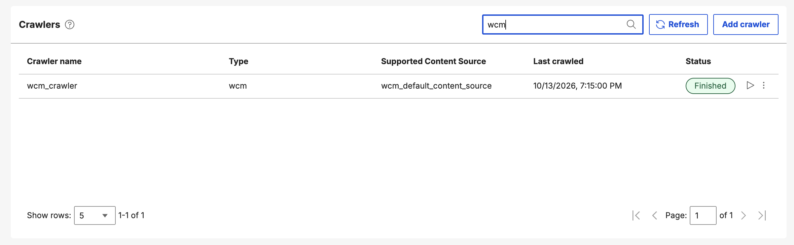

## Monitoring crawler status

The **Status** column shows the current status of each crawler, such as **New**, **Starting**, **Running**, **Finished**, **Stopped**, or **Failed**.

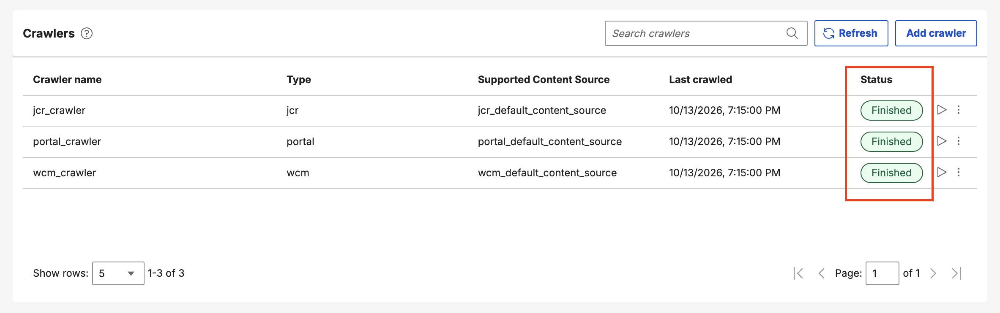

## Manually triggering a crawl

There are two ways to manually trigger a crawl for a supported content source:

- **Incremental crawl**: Click the **Incremental crawl** icon. The crawler runs and indexes the latest items from the seedlist that have not yet been indexed.

    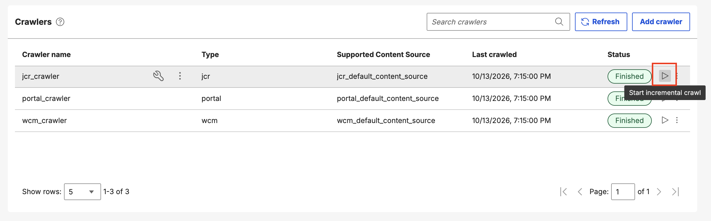

- **Re-crawl**: Click the **Overflow** icon, then click **Re-crawl** to start a full crawl.

    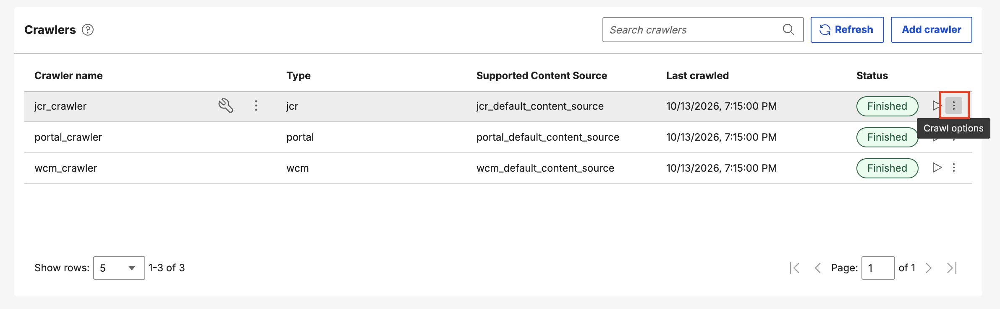

    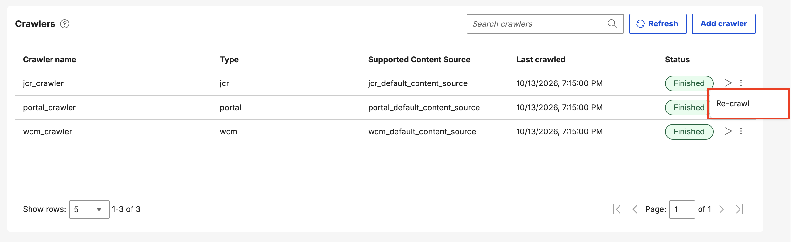

## Updating a crawler

1. Hover on a crawler row.
2. Click the **Properties** icon.

    

3. In the properties panel, update the properties, then click **Save**.

    

## Deleting a crawler

You can only delete a crawler that is not currently running.

1. Hover on a crawler row.
2. Click the **Overflow** icon, then click **Delete**.

    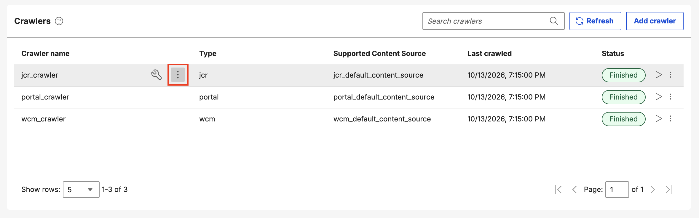

    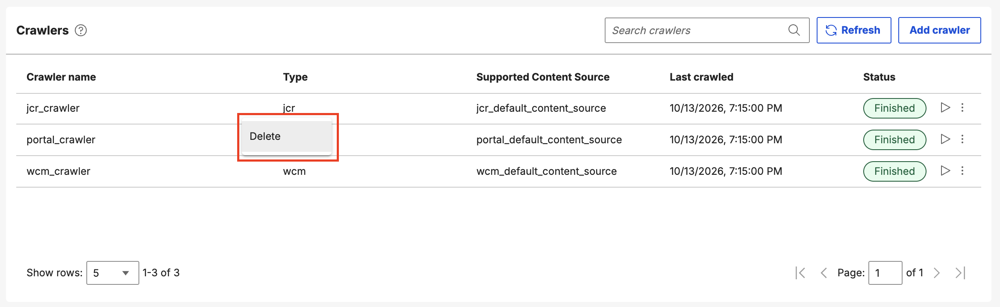

3. In the confirmation dialog, click **Delete** to confirm, or click **Cancel** to cancel the deletion.

    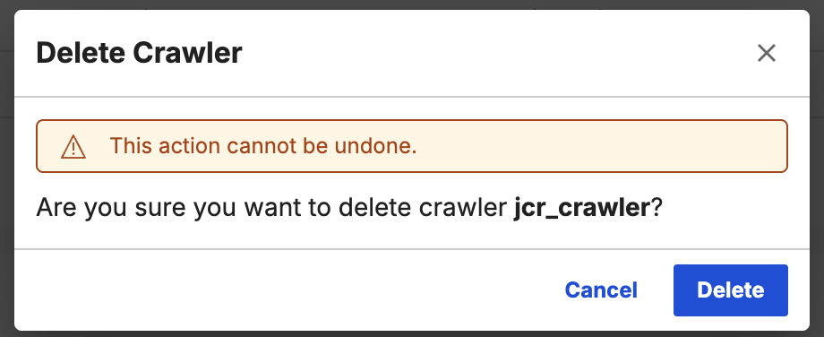

Deleting a crawler removes it from the list and makes it unavailable for search indexing.

## Stopping a crawl

1. Click the **Stop** icon.

    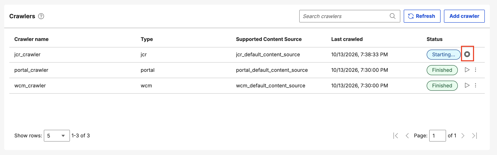

2. In the confirmation dialog, click **Stop** to confirm, or click **Cancel** to cancel the action.

    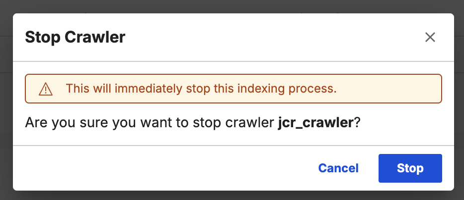

If the crawl was stopped, the status shows **Stopped**.
