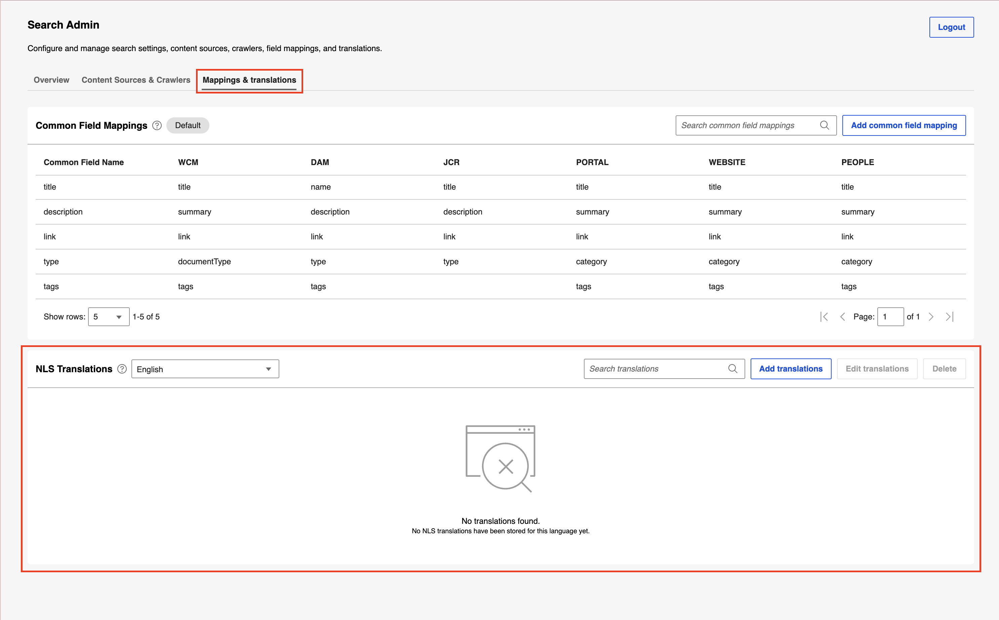
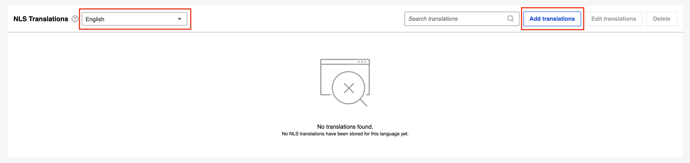
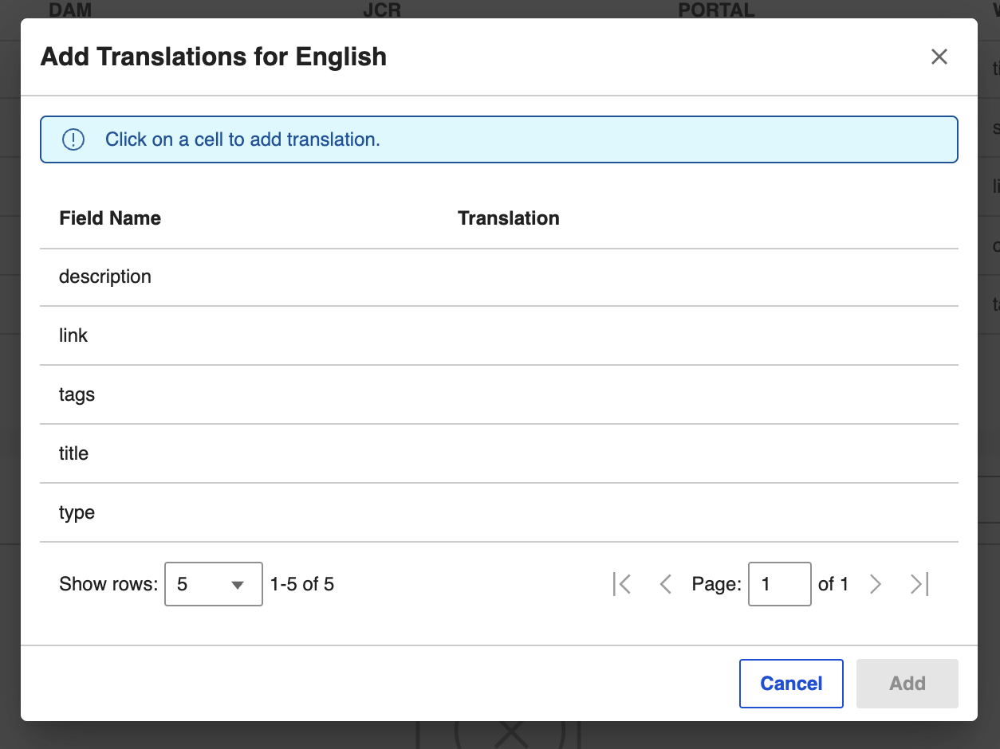
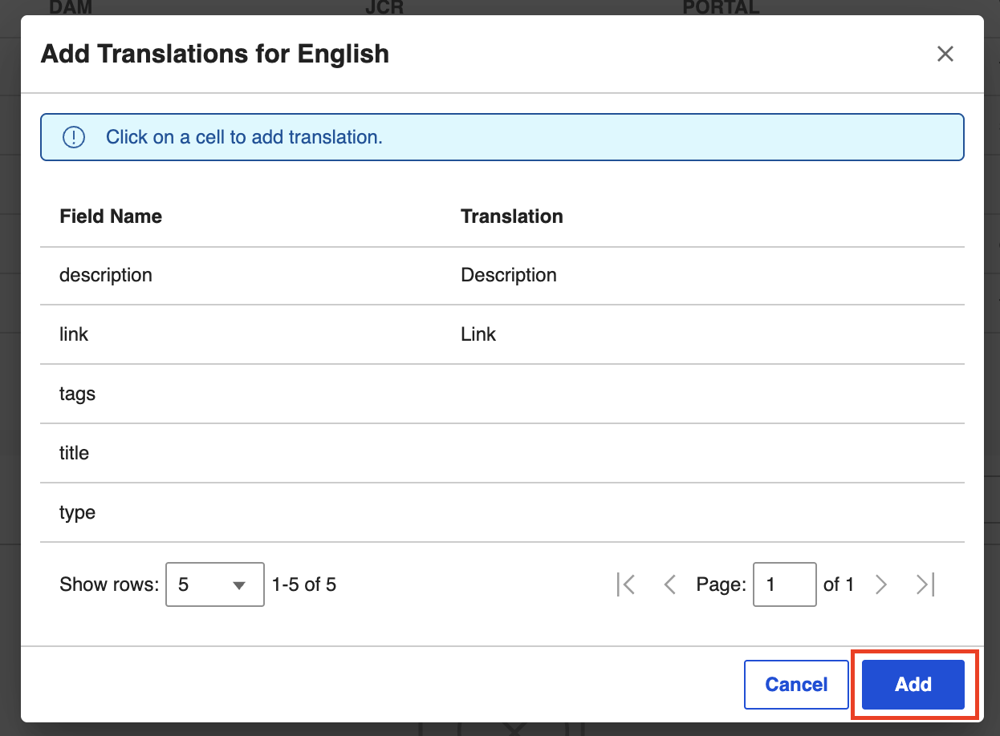
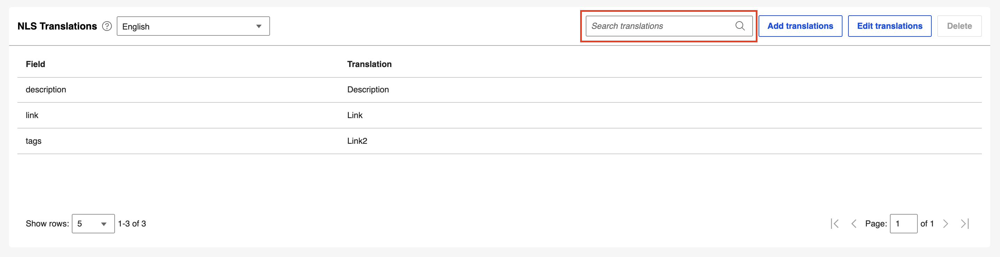
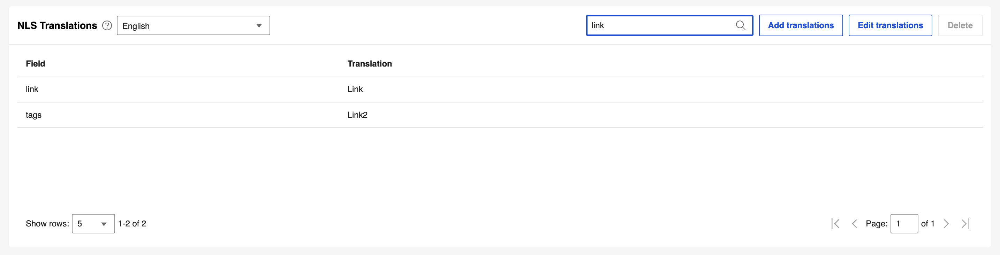
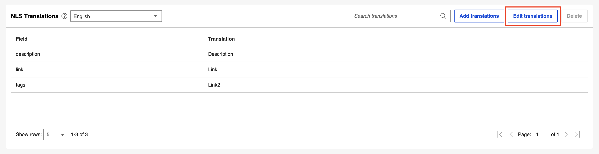
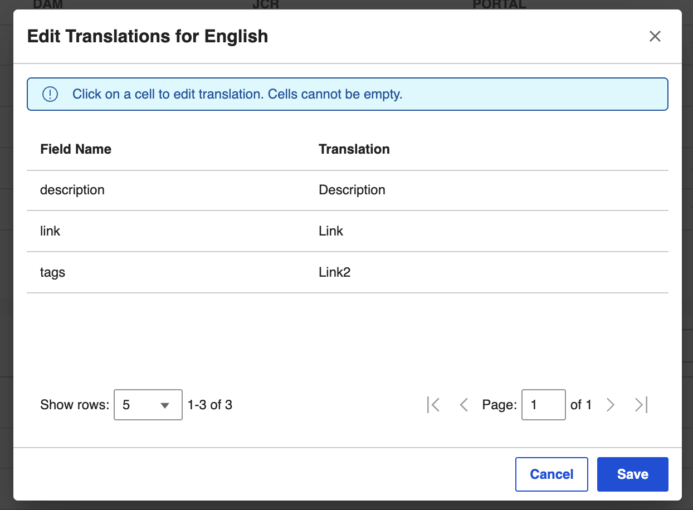
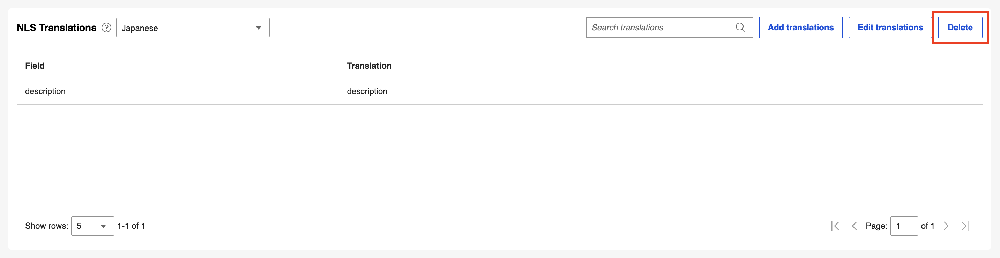
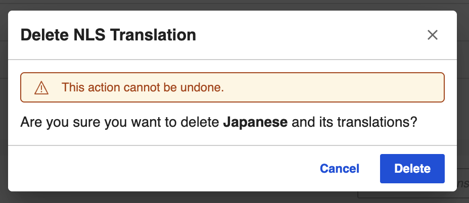

# Managing NLS translations

This section describes how to manage NLS (Native Language Support) translations in the Search Admin UI.

NLS translations let you provide translated labels for common field names so they display correctly in different languages.

On the **NLS Translations** panel, you can do the following tasks:

## Viewing NLS translations

1. Click the **Mapping & Translations** tab. The list of existing NLS translations is displayed.

    

## Adding an NLS translation

1. From the language dropdown, select the language you want to add translations for, then click **Add translations**.

    

2. In the dialog that opens, click a cell to start adding a translation for a common field.

    

3. Once you are done, click **Add**.

    

## Searching for an NLS translation

1. Type a search term in the **Search translations** field.

    

2. The list is filtered to show the results matching the search term.

    

## Updating an NLS translation

1. Click **Edit translations**.

    

2. In the dialog that opens, update the translations, then click **Save**.

    

## Deleting an NLS translation

You can delete the translations for any language except the default language, English.

1. Click **Delete**.

    

2. In the confirmation dialog, click **Delete** to confirm, or click **Cancel** to cancel the deletion.

    

All translations for the selected language are deleted.
