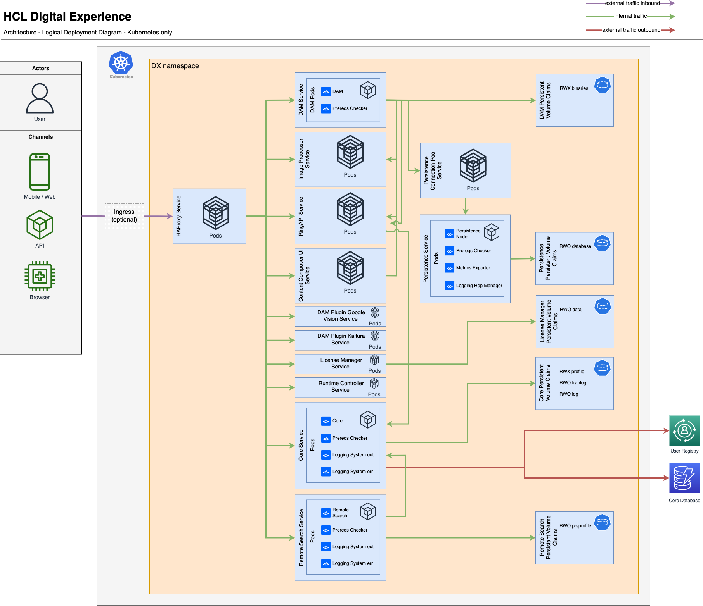

# Overview

Learn more about the containerization architecture, including the supported container platforms in deploying HCL Digital Experience images for your environment.

HCL introduced full support for containerization in Digital Experience (DX) 9.5. HCL Digital Experience users can deploy HCL Digital Experience images in Docker, Red Hat OpenShift 4.1 and higher, also Amazon Elastic Kubernetes Service (EKS), Microsoft Azure Kubernetes Service (AKS) and Google Kubernetes Engine (GKE) for test, development, staging, and production environments.

Whether developing, testing, or running a full production environment, use of Docker images and containers are preferred for the ease of deploying applications, including the latest version of HCL Digital Experience. Deploy in a fraction of the time than what it takes in the traditional deployment models.

Please see the [Containerization requirements and limitations](../../../get_started/plan_deployment/container_deployment/limitations_requirements.md) and [Deployment](../container/helm_deployment/overview.md) sections of the documentation before you begin.

## HCLSoftware U learning materials

For an introduction and a demo on DX deployment, go to [Deployment for Beginners](https://hclsoftwareu.hcl-software.com/component/axs/?view=sso_config&id=4&forward=https%3A%2F%2Fhclsoftwareu.hcl-software.com%2Fcourses%2Flesson%2F%3Fid%3D1479){target="_blank"}. Several deployment options are provided in the course.
