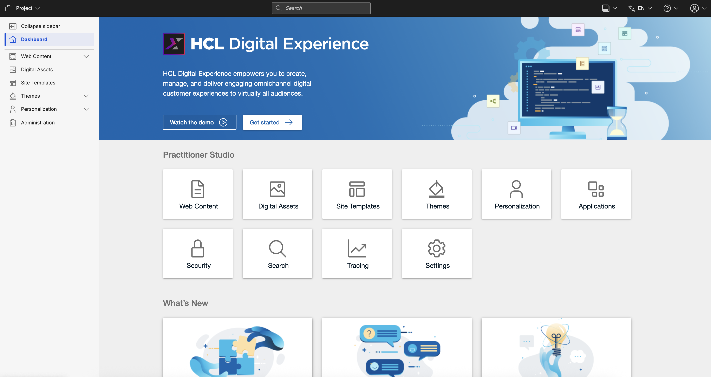
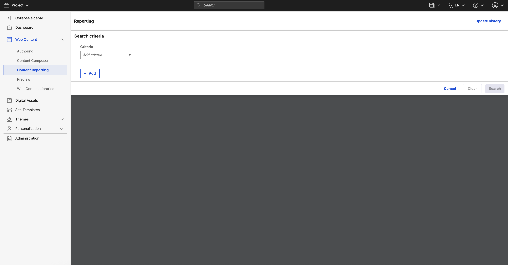
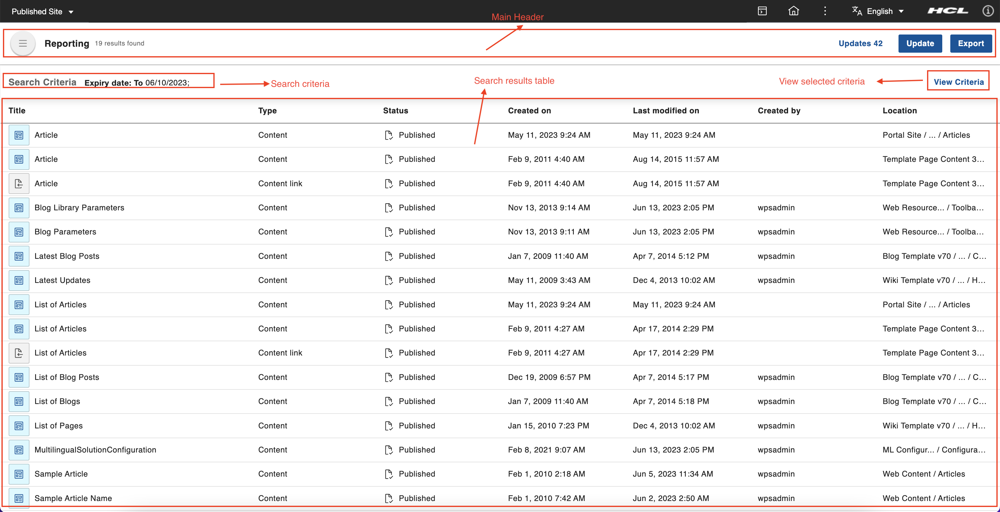
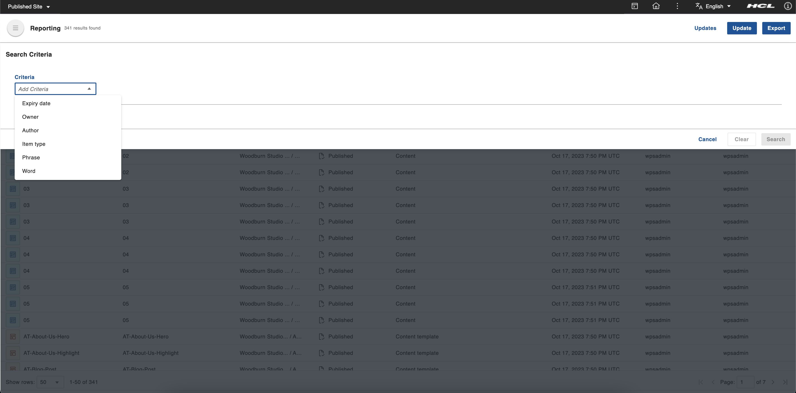
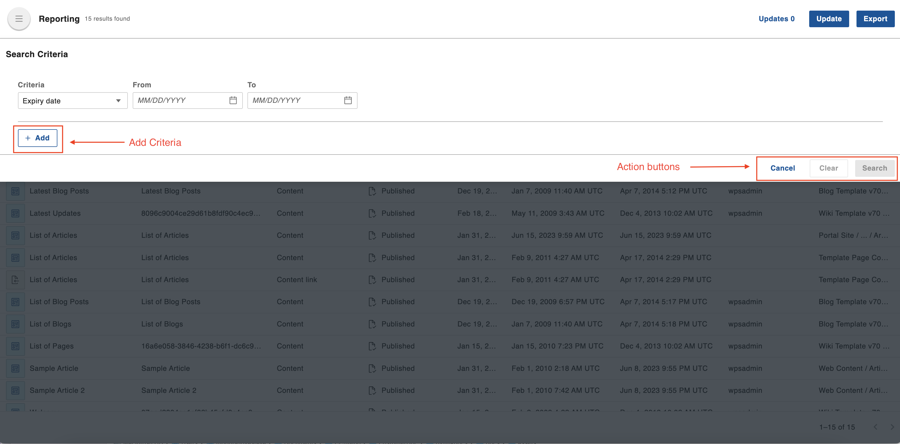

# Accessing the Content Reporting portlet

This section provides steps on how to access the HCL Content Reporting portlet and details on how each report criterion is interpreted.

## Prerequisite

Starting from HCL Digital Experience (DX) 9.5 CF214, Content Reporting is installed and deployed by default as part of the CF update process. However, for CF213, Content Reporting must be installed and configured. For instructions on installing Content Reporting manually on supported environments, see the [Installing HCL Digital Experience 9.5 Content Reporting](installation.md) topic.

After image configuration in your HCL DX 9.5 CF213 deployment, Content Reporting is accessible from the Practitioner Studio interface.

## Assigning resource permissions

You must have **User** or **Editor** access to the following resources to use Content Reporting. The **User** role does not have access to generating reports, updating in bulk, and exporting generated reports. This role can only view the Updates page containing bulk update history. The **Editor** role has no feature limitations.​ For more information, refer to [Working with resource permissions](../../../deployment/manage/security/people/authorization/controlling_access/working_with_resource_permission/index.md).

| Features            | User              | Editor             |
| --------------------| ----------------  | -------------------|
| Report generation   | :material-close:  | :material-check:   |
| Bulk update         | :material-close:  | :material-check:   |
| Export              | :material-close:  | :material-check:   |
| Updates             | :material-check:  | :material-check:   |

A user needs at least **User** access to an item for that item to be included in a report they generate. A user needs at least **Editor** access to an item for it to be successfully updated during a bulk update.

=== "Content reporting page"

    1. Select the **Administration menu** icon.
    2. Go to **Security** > **Resource Permissions** > **Pages** > **Content Root** > **Practitioner Studio** > **Web Content** > **Content Reporting**.
    3. Select the **Assign Access** icon to set the User role.

=== "Content reporting portlet"

    1. Select the **Administration menu** icon.
    2. Go to **Security** > **Resource Permissions** > **Portlets** > **Content Reporting portlet**.
    3. Select the **Assign Access** icon to set the User role.

=== "WCM REST SERVICES"

    1. Select the **Administration menu** icon.
    2. Go to **Security** > **Resource Permissions** > **Virtual Resources** > **WCM REST SERVICE**.
    3. Select the **Assign Access** icon to set the Editor role.

=== "WCM libraries and items"

    1. Select the **Web Content menu**.
    2. Go to **Web Content Libraries**.
    3. Select the **Assign Access** icon to set the User or Editor role for any library as needed.

## Accessing Content Reporting

Refer to the following instructions to access HCL DX 9.5 Content Reporting from the Practitioner Studio.

1. Log in to your HCL DX 9.5 platform, and select **Web Content** from the Practitioner Studio navigator.

    

2. Select **Content Reporting** from the **Web Content** menu to access the HCL Digital Experience 9.5 Content Reporting user interface.

    

## The HCL Content Reporting UI

The HCL Content Reporting UI has the following components:

- **Main header** - This section contains the total number of results found, a link for viewing completed and pending update actions, the **Update** button to update the expiry date of the reported items, and the **Export** button to export the search results into a CSV file.
- **Search Criteria** - This section displays a preview of all the criteria used to search for items to populate the report.
- **Report table** - This table contains the reported items in table format. By default, the table is arranged by title in alphabetical order. You can also sort the items in the report by **Name** or by **Last modified on**. When you change your sorting preference, it is applied even when you search with other criteria, at least until the user reloads the page.
- **View Criteria** - Click **View Criteria** to open the top drawer and display the criteria used for populating the report. You can set the criteria and generate a report in this drawer as well.

    

- **Criteria** - There are six criteria that can be used in different combinations as the basis to generate a report. The dynamic fields of each criterion is displayed after selection. A report can be generated based on any or all of the following criteria:

    - **Expiry date**
    - **Owner**
    - **Author**
    - **Item type**
    - **Phrase**
    - **Word**

- **Add Criteria** - This adds another criteria line by clicking **+ Add**. Only one instance of each option can be added at a time.

    

- **Action buttons**:

    - Click **Search** to proceed with the search.
    - Click **Clear** to clear the fields.
    - Click **Cancel** to close the search criteria drawer.
